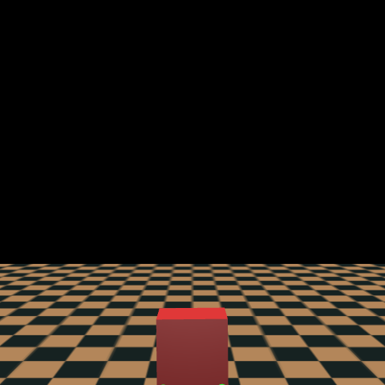

# WalkIA — Apprentissage par Renforcement & Robotique Quadrupède (MuJoCo / PPO)

> Simulation physique, environnement Gymnasium sur mesure et contrôle continu par politique PPO (*Proximal Policy Optimization*) — **ISIMA (Clermont Auvergne INP)**.

<p align="center">
  
</p>

## 🎯 Présentation du Projet

**WalkIA** est un projet d'exploration et d'ingénierie en apprentissage par renforcement profond (*Deep Reinforcement Learning*) appliqué au contrôle moteur continu d'un robot quadrupède (nom de code *"Canard"*).

L'objectif est d'entraîner un agent autonome à acquérir par lui-même une locomotion stable et efficace à partir de zéro (*tabula rasa*), sans trajectoire prédéterminée, en interagissant directement avec un moteur physique réaliste.

---

## 🏗️ Architecture & Conception Technique

### 1. Modélisation Physique & Cinématique (MuJoCo)
- **Modèle XML dédié (`assets/mon_robot.xml`) :** Définition complète des corps rigides, des masses, des moments d'inertie et des chaînes cinématiques articulées (torse, hanches, genoux, chevilles, palmes d'appui).
- **Espace d'action continu :** Contrôle des couples moteurs appliqués à l'ensemble des servomoteurs articulaires.
- **Espace d'observation (29 dimensions) :** Angles articulaires, vitesses angulaires, orientation du torse (quaternions), altitude absolue et signaux des capteurs d'impact au sol.

### 2. Environnement Gymnasium Sur Mesure (`MonRobotEnv`)
- Dérivation de `gymnasium.envs.mujoco.MujocoEnv`.
- Interrogation directe de l'état physique via l'API interne C/Python de MuJoCo (`self.model.body("torso").id` et `self.data.xpos` dans le repère global du monde).
- Détection géométrique précise des contacts physiques au sol (`self.data.contact`) pour discriminer les appuis normaux (palmes) des contacts anormaux (genoux, torse).

### 3. Reward Engineering & Traitement des Minima Locaux
L'un des défis majeurs du projet a été de concevoir une fonction de récompense évitant les optima locaux indésirables :
- **Posture & Stabilité :** Récompense incitative pour le maintien de l'altitude du torse dans une plage d'équilibre dynamique saine ($0.7\,\text{m} \le z \le 0.9\,\text{m}$).
- **Détection Anti-Triche :** Pénalité explicite en cas d'effondrement sur les genoux (minimum local découvert par l'agent pour éviter la chute sans maintenir son équilibre).
- **Dynamique de Marche :** Récompense de vitesse longitudinale couplée à une régularisation de l'énergie actionnée pour favoriser une foulée fluide et économe.

### 4. Algorithme d'Entraînement & Télémétrie
- **Algorithme PPO (*Proximal Policy Optimization*) :** Utilisation de Stable-Baselines3 avec architecture acteur-critique.
- **Télémétrie en temps réel (Pandas) :** Callback personnalisé calculant et journalisant à chaque étape les métriques clés de performance dans `data/stats_robot.csv` (durée moyenne de survie, vitesse d'avance, hauteur moyenne, taux de chute, ratio de succès).

---

## 📂 Organisation du Répertoire

```text
WalkIA/
├── assets/
│   └── mon_robot.xml         # Définition physique et cinématique du robot sous MuJoCo
├── data/
│   └── stats_robot.csv       # Télémétrie des entraînements et métriques de convergence
├── examples/
│   └── test_visuel.py        # Visualisation interactive 3D du modèle entraîné
├── models/
│   └── cerveau_mon_robot.zip # Poids du réseau de neurones pré-entraîné (PPO)
├── scripts/
│   ├── start_entrainement.sh # Script de lancement d'une session d'entraînement
│   └── start_visuel.sh       # Script de rendu graphique en direct
├── src/
│   ├── envs/
│   │   └── mon_env.py        # Environnement Gym personnalisé (dynamique, contacts, rewards)
│   └── train.py              # Pipeline d'entraînement, hyperparamètres et callback
└── robot_view.png            # Capture du modèle en simulation
```

---

## 🚀 Installation & Exécution

### Prérequis
- Python 3.10+
- MuJoCo (`pip install mujoco`)
- Gymnasium (`pip install gymnasium[mujoco]`)
- Stable-Baselines3 (`pip install stable-baselines3`)
- Pandas & NumPy (`pip install pandas numpy`)

### Visualiser l'agent entraîné
Pour observer le robot évoluer avec le modèle pré-entraîné dans la fenêtre de simulation MuJoCo :
```bash
python examples/test_visuel.py
```
*(ou via le script d'automatisation : `./scripts/start_visuel.sh`)*

### Lancer un entraînement
```bash
python src/train.py
```
*(ou via `./scripts/start_entrainement.sh`)*
